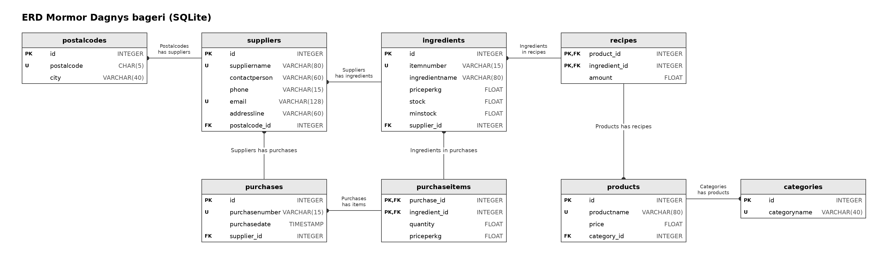

# Mormor Dagnys bageri, databas

Inlämningsuppgift 1 i kursen Databashantering (ITHS). En SQLite-databas som håller
ordning på bageriets leverantörer, råvaror, produkter med recept och inköp.

## Tabeller

- `postalcodes` postnummer och postort, så att orten bara skrivs en gång
- `suppliers` leverantörer med kontaktperson, telefon, e-post och adress
- `ingredients` råvaror med artikelnummer, kilopris, lager och vilken leverantör de köps från
- `categories` bröd, bullar och konditori
- `products` bageriets produkter
- `recipes` receptet för en produkt, en rad per råvara. Primärnyckeln är produkt + råvara så samma råvara bara kan finnas en gång i ett recept
- `purchases` och `purchaseitems` inköp från leverantörerna med rader per råvara

Skissen finns också som `docs/erd.drawio` om man vill ändra i den.

## Skripten

Ligger i `Scripts/` och körs i den här ordningen:

1. `createtables.sql` skapar tabellerna
2. `addtestdata.sql` lägger in testdata
3. `testqueries.sql` frågor som testar databasen, längst ner finns frågor som ska ge fel
4. `droptables.sql` tar bort allt om man vill börja om

`mormordagnys.db` är databasen som skripten skapade.

## Saker jag lärde mig

- I SQLite är foreign keys avstängda tills man kör `PRAGMA foreign_keys = ON;`. Utan den går det att lägga in en råvara med en leverantör som inte finns
- `INTEGER PRIMARY KEY AUTOINCREMENT` i SQLite är samma sak som `SERIAL PRIMARY KEY` i PostgreSQL
- Priset sparas på inköpsraden också, annars ändras gamla inköp när kilopriset ändras på råvaran
